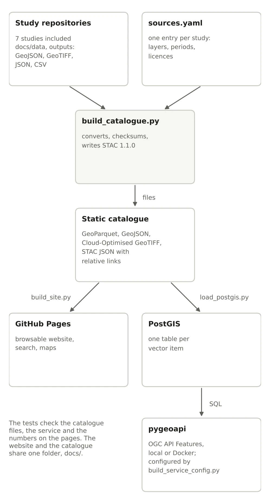
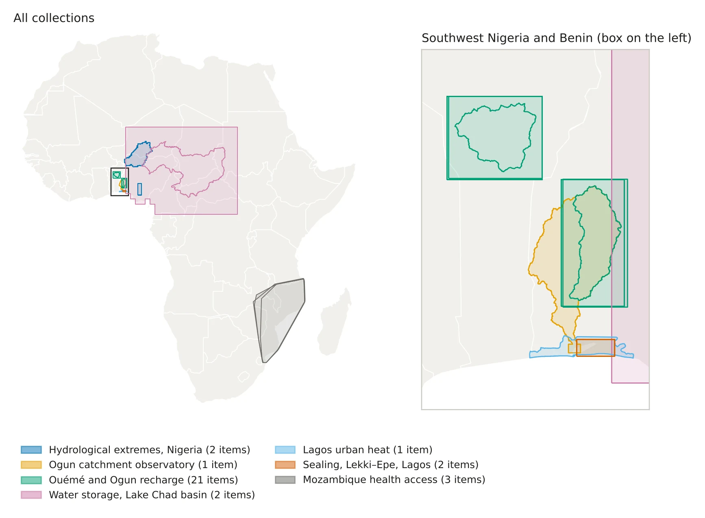
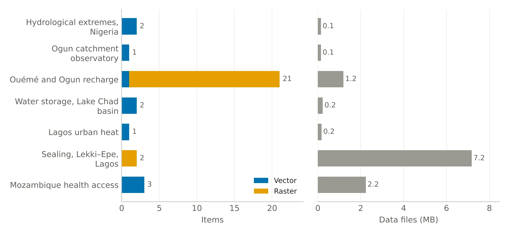

# Abstract

Seven open studies on hydrology, groundwater, urban heat, coastal sealing and access to health care in Africa each publish their results on a web page and in a GitHub repository. Their spatial outputs sit in different folders and formats, some only as JSON written for a chart. This note describes a catalogue that gathers them. A build script reads one configuration file, converts each listed layer to an open format and writes a static SpatioTemporal Asset Catalog (STAC) with 7 collections and 32 items: 10 vector layers with 4,162 features and 22 rasters, in 64 files of 11.3 MB with checksums. The catalogue is a set of JSON files with relative links, served by GitHub Pages next to a browsable website. The vector layers are also loaded into PostGIS and served as OGC API Features collections by pygeoapi; that service runs locally or with Docker Compose, not on the static site. Automated tests validate the catalogue against the STAC schemas and query the service. The catalogue adds no new analysis: each layer keeps the meaning and the limits given by its study.

# 1. Why a catalogue

Each study page shows maps, but a reader who wants the layers behind them has to find the right file in the right repository, and some of those files are not GIS formats: the per-cell rainfall return levels of the Nigerian extremes study and the per-cell storage trends of the Lake Chad study are stored as JSON for the page's own map, and the Mozambique facility lists as a CSV table. A catalogue gives each layer a stable address, a description, a time range, an extent, a licence and a checksum, and offers it in formats that GIS software and code read directly.

Two standard ways of publishing such data were used. STAC describes files and their metadata as linked JSON documents and needs no server (STAC, 2024). OGC API Features is a web service standard for querying vector features, for example by bounding box, page by page (OGC, 2022). The first suits a static website; the second needs a database and a running server.

# 2. Design

Figure 1 shows the path of a layer: from a study repository, through the build script, into the static catalogue; from there the website is written, and the vector layers are loaded into the database behind the service.

## 2.1 One configuration file

`catalogue/sources.yaml` lists the studies. Each entry gives the repository, a title and description, the licences the study states and the file that states them, and the layers to include with a title, a description and a time range. A time range can also be read from a field of the layer or from a JSON results file of the study, so it is not typed twice. If an entry lists no layers, every GeoJSON and GeoTIFF file in the study's `docs/data` and `outputs` folders is taken. If the repository, its outputs, a study period or a licence statement is missing, the entry is skipped and reported on the website. In all, 8 studies are configured; at the last build one was skipped (Mau-Forest-Land-Cover: no GeoJSON or GeoTIFF outputs found).

## 2.2 Formats, checksums and size limits

Vector layers are written as GeoParquet 1.1 (GeoParquet, n.d.) and GeoJSON, in longitude–latitude (EPSG:4326). Five layers were converted from files written for the study pages (JSON or CSV): grid cells to polygons, facility tables to points, and a district table joined to its outlines. Rasters are written as Cloud-Optimised GeoTIFFs (OGC, 2023) with rio-cogeo, in their original grid and projection, together with a small PNG quick-look in EPSG:4326 for the website. The catalogue holds 10 GeoParquet files (0.7 MB), 10 GeoJSON files (2.3 MB), 22 GeoTIFFs (7.5 MB) and 22 quick-looks (0.7 MB). The largest file is 3.5 MB.

Every file carries its size and SHA-256 checksum (STAC file extension), raster items carry their grid (projection extension) and vector items their columns and feature count (table extension). A converted file larger than 20 MB would not be copied: its asset would point to the source file in the study repository instead. No file reached that limit, so every file is in the catalogue itself. The build also stops if the website folder would exceed 150 MB.

Each collection records the study page, the repository, the data licence (CC BY 4.0 for 5 of the 7 studies, with exceptions noted below) and the commit of the study repository the files were taken from. The Coastal-Hydrogeology-Modeling repository states an MIT licence and no separate licence for its derived data, so its collection is marked “other” until the author states one. The Mozambique-Health-Access collection is marked “various”: each of its three items states its own licence (CC BY 4.0, ODbL 1.0), because the layer derived from OpenStreetMap is under the ODbL, as the study states. In Ogun-Catchment-Coast-Observatory, the SAR flood fields (sar_flood_km2, sar_flood_max_km2, dw_flood_km2, sar_inundation_km2) use a MERIT Hydro height-above-drainage mask, which is dual-licensed CC BY-NC 4.0 or ODbL 1.0; if you reuse these fields commercially, check MERIT Hydro's terms (see LICENSE-DATA.md of the study). In Lagos-Urban-Heat-Analytics, LGA boundaries are FAO GAUL 2015 (non-commercial use only); see LICENSE-DATA.md of the study.

## 2.3 A static catalogue on GitHub Pages

The catalogue is saved as a self-contained STAC catalogue: links between the root catalogue, collections and items are relative, and there are no `self` links, so the folder works wherever it is copied. The website is built from the same files. The index page lists the collections with small extent maps drawn with a copy of Leaflet on country outlines from Natural Earth, without a tile server, and a search box filters the items in the browser. Each collection and item has its own page with a map, the metadata and the files. The pages load their fonts from api.fontshare.com and, on the published site only, a reaction and page-view counter from abacus.jasoncameron.dev; Leaflet and the map outlines are served from the site itself, and nothing else is requested from a third party.

## 2.4 OGC API Features with PostGIS and pygeoapi

`scripts/load_postgis.py` reads the GeoParquet file of each vector item and creates one PostGIS table per item with an integer key, the layer's attributes and a geometry column in SRID 4326 with a spatial index. `scripts/build_service_config.py` writes a pygeoapi configuration with one collection per table, its extent and time range, and links back to the STAC item and the study page (pygeoapi, n.d.; PostGIS, n.d.). Connection settings come from environment variables, so the same file works locally, in Docker Compose and in the test workflow.

One detail mattered. When the storage coordinate system was declared as EPSG:4326, pygeoapi returned every coordinate with latitude and longitude swapped, because EPSG:4326 formally lists latitude first; the data are stored longitude first. The configuration therefore declares the storage system as CRS84, and a test checks that each returned feature lies inside the extent of its collection.

# 3. Checks

The tests (`tests/`) do three things. They validate every catalogue file against the STAC 1.1.0 schema and the schemas of the extensions it uses, check that every link and asset resolves, that sizes and checksums match the files, that every GeoTIFF is a valid Cloud-Optimised GeoTIFF and that GeoParquet and GeoJSON agree. They start a temporary PostgreSQL database with PostGIS, load the layers, start pygeoapi through its Flask test client and query it. They check that every number on the website matches the generated files. A separate browser check opens every page at phone and desktop width.

At the last service check (2026-11-19), pygeoapi 0.24.0 served 10 collections with 4,162 features from PostGIS 3.4.2 on PostgreSQL 16.15. For every collection the check read one page of one feature, all features page by page, single features by identifier, a small bounding box around a known feature (the returned set had to equal the features that intersect it) and a bounding box in the South Pacific (none returned). pygeoapi declares 18 conformance classes; the tests exercise the core, GeoJSON and OpenAPI 3.0 classes of OGC API Features Part 1 through these queries only. No formal OGC conformance test suite was run.

# 4. What the catalogue holds

| Study | Items | Vector features | Files | MB | Period | Data licence |
| :--- | ---: | ---: | ---: | ---: | :--- | :--- |
| [Floods, droughts and design rainfall in two data-sparse Nigerian basins](https://oloyededavid.github.io/Observational-Hydrology-Extremes/) | 2 | 274 | 4 | 0.1 | 1981–2070 | CC BY 4.0 |
| [Ogun River catchment-to-coast environmental observatory](https://oloyededavid.github.io/Ogun-Catchment-Coast-Observatory/) | 1 | 5 | 2 | 0.1 | 2019–2024 | CC BY 4.0 |
| [Testing a satellite water balance for groundwater recharge: Upper Ouémé and Upper Ogun](https://oloyededavid.github.io/Oueme-Ogun-Groundwater-Recharge/) | 21 | 2 | 42 | 1.2 | 2018–2024 | CC BY 4.0 |
| [Water storage in the Lake Chad basin from GRACE and GRACE-FO](https://oloyededavid.github.io/Groundwater-Storage-Gravimetry/) | 2 | 377 | 4 | 0.2 | 2002–2026 | CC BY 4.0 |
| [Surface urban heat island and distance to vegetation in Lagos State](https://oloyededavid.github.io/Lagos-Urban-Heat-Analytics/) | 1 | 20 | 2 | 0.2 | 2022–2024 | CC BY 4.0 |
| [Urban sealing and the shallow water table of the Lekki–Epe barrier, Lagos](https://oloyededavid.github.io/Coastal-Hydrogeology-Modeling/) | 2 | 0 | 4 | 7.2 | 1986–2024 | not stated |
| [Travel time to health facilities in Mozambique](https://oloyededavid.github.io/Mozambique-Health-Access/) | 3 | 3,484 | 6 | 2.2 | 2019–2024 | various |

Most of the studies lie in southwest Nigeria and Benin; the others cover two Nigerian river basins, the Lake Chad basin and Mozambique (Figure 2). Most items come from one study, the rainfall, evapotranspiration and water-surplus grids of the Ouémé and Ogun recharge study, while most of the data volume is in the rasters of the Lekki–Epe sealing study (Figure 3).

The periods are those of the layers, not of the studies: for example the Lagos layer holds the attributes of an earlier Earth Engine export, and its own period field is used.

# 5. Limits

The catalogue copies the studies' outputs at one commit each. If a study changes, the catalogue is out of date until it is rebuilt, and the build needs the study repositories on the same machine; the test workflow checks the committed catalogue but cannot rebuild it. Most layers are satellite or model estimates, not measurements, and their uncertainty is described in the studies, not here. Only outputs already stored in the repositories are included; large intermediate rasters that the studies rebuild from public archives are not. The service is a demonstration that the layers can be served through a standard interface; it has not been deployed, load-tested or secured for public use.

# Data and code

The catalogue, the scripts that build it and the tests are in the repository (https://github.com/oloyededavid/Open-Geodata-Catalogue). Every number in this note is read from `docs/data/catalogue_stats.json` and `docs/data/service_check.json`, which the build and check scripts write.

# References

GeoParquet (n.d.). GeoParquet specification, version 1.1.0. Accessed November 2026. https://geoparquet.org/releases/v1.1.0/

OGC (2022). OGC API – Features – Part 1: Core, corrigendum. Open Geospatial Consortium, document 17-069r4. https://docs.ogc.org/is/17-069r4/17-069r4.html

OGC (2023). OGC Cloud Optimized GeoTIFF Standard. Open Geospatial Consortium, document 21-026. https://docs.ogc.org/is/21-026/21-026.html

PostGIS (n.d.). PostGIS spatial database extension for PostgreSQL. Accessed November 2026. https://postgis.net

pygeoapi (n.d.). pygeoapi: a Python server implementation of the OGC API suite of standards. Accessed November 2026. https://pygeoapi.io

STAC (2024). SpatioTemporal Asset Catalog specification, version 1.1.0, released 10 September 2024. https://stacspec.org
